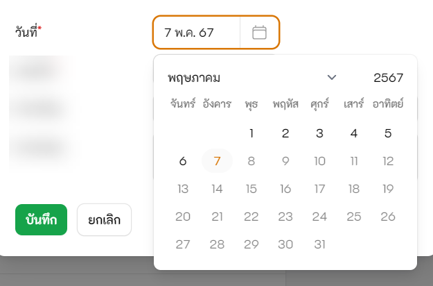

# FilamentPHP Thai Date Picker Form Component

[](https://packagist.org/packages/phattarachai/filament-thai-date-picker)
[](https://github.com/phattarachai/filament-thai-date-picker/actions/workflows/run-tests.yml?query=branch%3Amain)
[](https://github.com/phattarachai/filament-thai-date-picker/actions/workflows/fix-php-code-style-issues.yml?query=branch%3Amain)
[](https://packagist.org/packages/phattarachai/filament-thai-date-picker)

[](https://packagist.org/packages/phattarachai/filament-thai-date-picker)

ปฏิทิน Thai Date Picker สำหรับ Filament Form Component
วัน/เดือน/ปีที่แสดงใน Form เป็นภาษาไทย (พ.ศ.) แต่เก็บเข้า Model เป็นปี ค.ศ.ตามปกติ



## Version ที่รองรับ

| ThaiDatePicker | Filament | PHP  | Laravel      | สถานะ                    |
|:---------------|:---------|:-----|:-------------|:-------------------------|
| 4.x            | 5.x      | 8.3+ | 12, 13       | เวอร์ชันหลัก พัฒนาต่อเนื่อง |
| 3.x            | 5.x      | 8.2+ | ตาม Filament | แก้บั๊กเท่านั้น              |
| 2.x            | 4.x      | 8.2+ | ตาม Filament | แก้บั๊กเท่านั้น              |
| 1.x            | 3.x      | 8.1+ | ตาม Filament | แก้บั๊กเท่านั้น              |

ใช้ Filament 5 อยู่บน PHP 8.2 หรือ Laravel 11 ให้ใช้ 3.x (`^3.0`) ส่วนโปรเจกต์ใหม่ใช้ 4.x

## วิธีติดตั้ง

Run คำสั่ง composer require เพื่อติดตั้ง Package

```bash
composer require phattarachai/filament-thai-date-picker
```

ทำการ publish ไฟล์ javascript ของ picker (ถ้าใน `post-autoload-dump` ของ composer.json มีคำสั่งนี้อยู่แล้ว ข้ามขั้นตอนนี้ได้)

```bash
php artisan filament:upgrade
```

## วิธีใช้งาน ThaiDatePicker

ใช้เหมือน DatePicker ปกติ แต่เรียกใช้ class ThaiDatePicker แทน

```php
use Phattarachai\FilamentThaiDatePicker\ThaiDatePicker;

ThaiDatePicker::make('order_date')
    ->label('วันที่สั่งซื้อ')
    ->suffixIcon('heroicon-o-calendar')

```

แบบ มีเวลา

```php
use Phattarachai\FilamentThaiDatePicker\ThaiDateTimePicker;

ThaiDateTimePicker::make('transfer_at')
    ->label('เวลาที่โอน')
    ->suffixIcon('heroicon-o-calendar')

```

โดยปี พ.ศ.จะใช้สำหรับการแสดงผลเท่านั้น เวลาใช้งาน state เพื่อบันทึกลงฐานข้อมูลจะได้เป็นปี ค.ศ. ตามปกติ

```php

$data = $this->form->getState();
// $data['order_date'] = '2024-05-17'

```

## การแสดงวันที่ภาษาไทยใน Infolist

นอกจาก Datepicker แล้วใน package นี้เพิ่ม method `thaidate()` และ `thaidatetime()`
สำหรับช่วยการแสดงผล Infolist วันที่ปี พ.ศ. ภาษาไทย

```php
use Filament\Infolists\Components\TextEntry;

TextEntry::make('order_date')
    ->label('วันที่สั่งซื้อ')
    ->thaidate(),
    // 18 พ.ค. 67
```

```php
use Filament\Infolists\Components\TextEntry;

TextEntry::make('created_at')
    ->label('วันที่สร้าง')
    ->thaidatetime(),
    // 18 พ.ค. 67 12:05
```

ถ้า field วันที่เป็นค่า null ได้ และต้องการให้แสดงค่า default ให้ส่ง parameter `default` เข้าไป

```php
use Filament\Infolists\Components\TextEntry;

TextEntry::make('confirm_date')
    ->label('วันที่ยืนยัน')
    ->thaidate(default: '-'),
    // -
```

## การแสดงวันที่ภาษาไทยใน Table Column

เช่นเดียวกับ Infolist package นี้เพิ่ม macro method `thaidate()` สำหรับการ format
การแสดงผลคอลัมน์วันที่เพื่อให้แสดงผลเป็นปี
พ.ศ. ภาษาไทย ได้เลย

```php
use Filament\Tables;

Tables\Columns\TextColumn::make('order_date')
    ->label('วันที่')
    ->thaidate()
    // สามารถระบุ date format ได้เหมือน function date_format ของ PHP
    // default format เป็น j M y
    // เช่น 18 พ.ค. 67

```

ถ้าเป็น วันที่และเวลาใช้ method `thaidatetime()`

```php
use Filament\Tables;

Tables\Columns\TextColumn::make('created_at')
    ->label('วันที่สร้าง')
    ->thaidatetime()
    // default format เป็น j M y H:i
    // เช่น 18 พ.ค. 67 12:00

```

ทั้ง `thaidate()` และ `thaidatetime()` ใน Table Column และ Infolist รับ parameter ชุดเดียวกัน

```php
->thaidate(format: 'j F Y', timezone: 'Asia/Bangkok', default: '-')
// 18 พฤษภาคม 2567
```

- `format` — date format ของ PHP เช่น `j F Y` สำหรับชื่อเดือนเต็ม
- `timezone` — ถ้าไม่ระบุ จะใช้ timezone ของ column หรือ entry นั้น
- `default` — ข้อความที่แสดงเมื่อค่าเป็น null

ถ้าต้องการแสดงเวลาเป็นบรรทัดรองใต้วันที่ ใช้ `timeDescription()` กับ column ที่ cast เป็นวันที่

```php
Tables\Columns\TextColumn::make('created_at')
    ->thaidate()
    ->timeDescription()
    // 18 พ.ค. 67
    // 12:05
```

## ผู้พัฒนา

พัฒนาและดูแลโดย [บริษัท ภัทรชัย อาร์ทิซาน จำกัด](https://phattarachai.dev) (Phattarachai Artisan)
บริษัทที่ปรึกษาและพัฒนาเว็บ ที่เรียนรู้และแบ่งปันกับชุมชน Laravel
แพ็กเกจนี้แบ่งปันให้ชุมชนนำไปใช้และต่อยอดได้อย่างอิสระ

ดูแพ็กเกจอื่นของเราได้ที่ [phattarachai.dev/open-source](https://phattarachai.dev/open-source)
และติดต่อเราได้ที่ [phattarachai.dev](https://phattarachai.dev/#contact)

## License

The MIT License (MIT).
